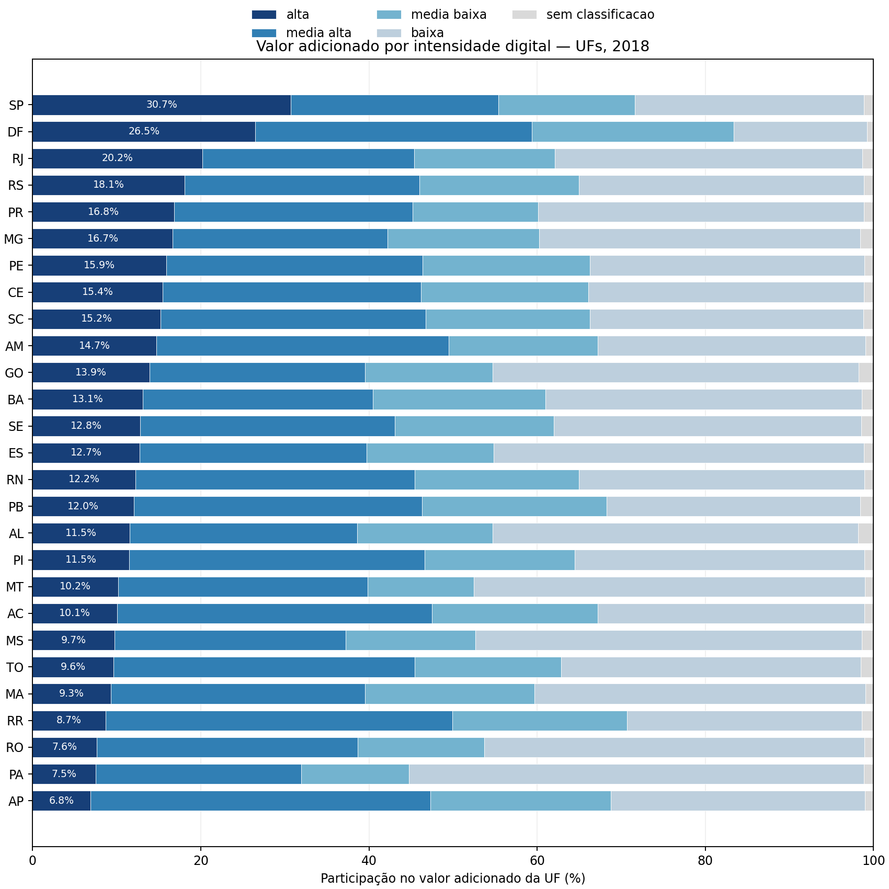
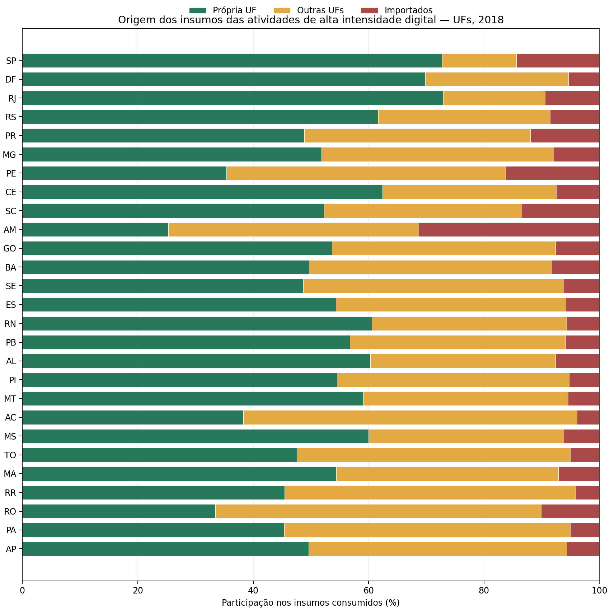

# Resumo

**1. Identificação de metodologias internacionais**

Existem metodologias internacionais para classificar as atividades econômicas segundo sua intensidade digital:

- [OCDE (2023) — Handbook on Compiling Digital Supply and Use Tables](https://www.oecd.org/content/dam/oecd/en/publications/reports/2023/11/oecd-handbook-on-compiling-digital-supply-and-use-tables_b127cb7a/11a0db02-en.pdf)
- [OCDE (2018) — A Taxonomy of Digital Intensive Sectors](https://www.oecd.org/content/dam/oecd/en/publications/reports/2018/06/a-taxonomy-of-digital-intensive-sectors_3a1f0ed9/f404736a-en.pdf)
- [OIT — Publicação sobre emprego digital](https://www.ilo.org/sites/default/files/wcmsp5/groups/public/@ed_emp/documents/publication/wcms_901252.pdf)

**2. Compatibilização das classificações setoriais**

As metodologias permitem classificar as atividades econômicas por intensidade digital (ver Anexo 2, p. 141, Itaú, 2026). Entretanto, utilizam classificações internacionais, como a ISIC, sendo necessário compatibilizá-las com as atividades do Sistema de Contas Nacionais (SCN) brasileiro. <span style="color: red;">Esse dicionário é relativamente simples de construir, pois existem mais atividades no SCN do que categorias de intensidade tecnológica. Contudo, **o dicionário apresentado é apenas uma proposta preliminar e deve ser revisado e validado!**</span>

**3. Construção de indicadores de soberania digital**

A partir dessa classificação e dos dados do SCN e das contas regionais, propõe-se construir dois indicadores:

- **3.1. Distribuição regional:** identificar em quais estados brasileiros se concentram as atividades econômicas de diferentes intensidades digitais.
- **3.2. Dependência produtiva:** identificar, para cada estado, quanto do consumo intermediário das atividades de alta intensidade digital é fornecido pelo próprio estado, por outros estados brasileiros ou por importações internacionais.


## Dados

Esta versão calcula os indicadores e gráficos diretamente da planilha **MIP-Ir Brasil, ano-base 2018**, obtida no
[Atlas Econômico do Ipea](https://www.ipea.gov.br/atlaseconomico/) e
[compartilhada aqui](https://docs.google.com/spreadsheets/d/1R9Vmk1ZalwWB6QUt-_MJKfA67VFSRTlS/edit?usp=sharing&ouid=115437974636004873212&rtpof=true&sd=true).


## Reprodução

1. O primeiro script lê o XLSX desse
   link; a planilha bruta não está no Git. O arquivo deve estar acessível para
   quem executar o script.
2. Instale `numpy`, `pandas`, `openpyxl` e `matplotlib`.
3. Execute os scripts na ordem dos prefixos:

```bash
python 01-dados_atlas_ipea.py
python 02_calcular_indicadores.py
python 03_gerar_graficos.py
```


## Indicadores





O primeiro gráfico mostra a
composição do valor adicionado da UF; o segundo separa os insumos consumidos
pelas atividades de alta intensidade entre própria UF, outras UFs e importações.

## Definições

Para cada faixa, o **valor adicionado** é a soma dos componentes de `VA_dnj`
nas atividades da faixa. A participação nacional usa como denominador o valor
adicionado da mesma faixa em todas as UFs. A participação na UF usa como
denominador o valor adicionado de todas as atividades da UF. As grandezas
monetárias conservam a unidade original da MIP-Ir.

A origem dos **insumos consumidos** é medida pelo destino da atividade: soma
de `CI_nac_iknj` com `i = n` para a própria UF, com `i != n` para as demais UFs,
e de `CI_bnj[1]` para o exterior. O denominador dos percentuais é a soma dessas
três origens. Os campos da faixa `alta` mostram quanto dos insumos consumidos
pelas atividades de alta intensidade digital em cada UF vêm de cada origem.


